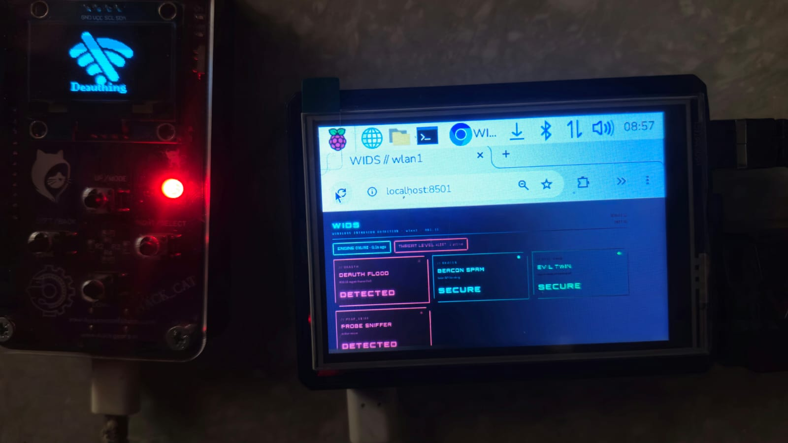
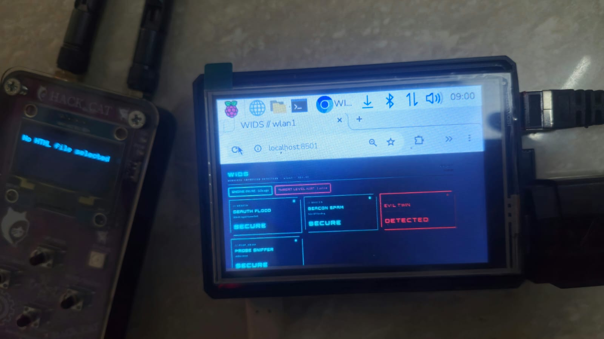
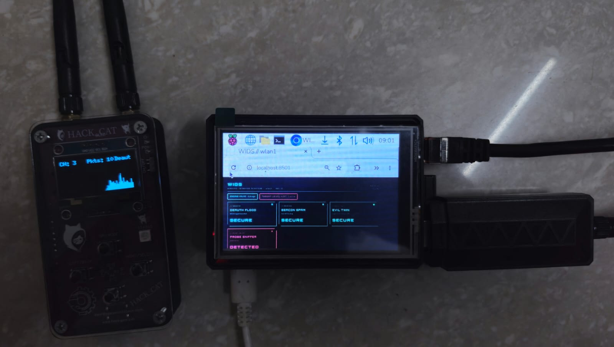
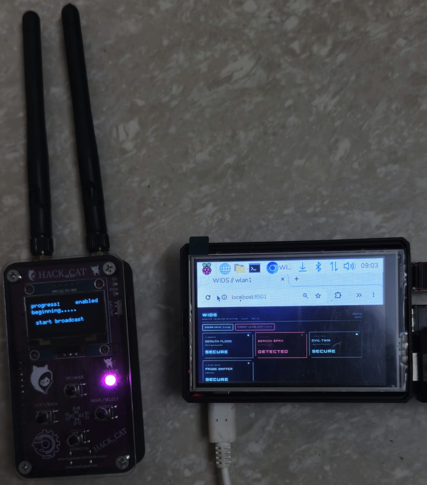

# WIDS — Wireless Intrusion Detection System

A lightweight, **rule-based (no machine learning)** wireless IDS for the Raspberry Pi. An Atheros AR9271 USB adapter sits in monitor mode; **tshark** and **Scapy** read the 802.11 management frames; four threshold-based detectors raise alerts; a Streamlit dashboard shows live status.

> **Status: working prototype, 802.11 (Layer 1–2) only.** All four detectors have been seen firing on my own network while testing with a HackCat attack tool. Read [Validation status](#validation-status) for exactly what has and has not been measured.

## What it detects

| Detector | Attack | Rule (defaults) | Clears when |
|---|---|---|---|
| `DEAUTH` | Deauthentication flood | ≥ 2 deauth frames in 1 s | 3 s after the last flood frame |
| `BEACON` | Beacon spam / fake-AP flood | ≥ 15 unique BSSIDs within 10 s | the count drops below 15 |
| `EVIL_TWIN` | Rogue AP cloning your SSID | trusted SSID seen from an untrusted BSSID (beacon or probe response) | 30 s after the last rogue frame |
| `PCAP_SNIFF` | Probe-request sniffer / scanner | ≥ 3 probe requests from one MAC in 1 s | 30 s after the last hit |

Hold timers give each detector hysteresis, so an alert does not flicker while an attack is still running. Full rules: [docs/DETECTION_RULES.md](docs/DETECTION_RULES.md).

## Live demo

The dashboard on a 3.5" Pi touchscreen while a HackCat attacks my own network (Pi clock shown in the taskbar).

<table>
<tr>
<td><br><sub>Deauth flood detected (HackCat: "Deauthing")</sub></td>
<td><br><sub>Evil Twin detected</sub></td>
</tr>
<tr>
<td><br><sub>Probe sniffer detected</sub></td>
<td><br><sub>Beacon spam detected (HackCat: "start broadcast")</sub></td>
</tr>
</table>

## How it works

```
 AR9271 (monitor mode, wlan1)
        │
        ├── tshark  -f "type mgt"   ──►  deauth / beacon / evil-twin rules ─┐
        │                                                                    ├─► shared state (RLock)
        └── Scapy sniff (probe req) ──►  probe-sniffer rule ────────────────┘         │
                                                                                      ├─► wifi_log.json     (live snapshot, every 1 s)
                                                                                      ▼
                                                                          Streamlit dashboard :8501
```

More detail: [docs/ARCHITECTURE.md](docs/ARCHITECTURE.md).

## Requirements

**Tested on** (the only setup I have run):

- Raspberry Pi 4 (quad-core Cortex-A72 @ 1.5 GHz), Raspberry Pi OS (Debian 13 "Trixie")
- Atheros AR9271 USB Wi-Fi adapter (`ath9k_htc` driver), appears as `wlan1`
- Built-in `wlan0`, left in normal mode; it is only used to scan for your AP's channel
- Ethernet to your laptop. A deauth attack kills Wi-Fi, so view the dashboard over the wire.
- A modest sensor on purpose: about 2.9 GB of RAM free after the OS install and a basic SanDisk microSD card below Class 10. See [Design constraints](docs/ARCHITECTURE.md#design-constraints).

**What you need to reproduce it:**

| Requirement | Why |
|---|---|
| A Wi-Fi adapter that supports **monitor mode** on 2.4 GHz (AR9271 / `ath9k_htc` is the one tested; others are untested) | the engine reads raw 802.11 management frames |
| A **second** Wi-Fi interface (the Pi's built-in one works) | an interface in monitor mode cannot scan, so one is needed to find your AP's channel |
| `tshark`, `iw`, Python 3, `scapy`, `streamlit` | capture, channel control, probe analysis, dashboard (`pip install -r requirements.txt`) |
| `root` for the engine and the monitor-mode script | packet capture and interface control (the dashboard needs no sudo) |
| Your own router's SSID and **every** BSSID (2.4 GHz and 5 GHz radios) | `EVIL_TWIN` trusts only the BSSIDs you list in `TRUSTED_APS`; leaving the placeholder in place means it will not work correctly |
| A network and devices **you own**, plus a test tool of your own if you want to generate attacks | the repo has no attack code; see [Responsible use](#responsible-use) |

Not required: a fast SD card or a large amount of RAM, but see the design constraints above for what that means for logging.

## Quick start

```bash
sudo apt update && sudo apt install -y tshark iw python3-pip
# "Should non-superusers be able to capture packets?"  ->  No (the engine runs as root)

git clone https://github.com/<your-user>/wids-tshark.git ~/wids && cd ~/wids
pip install --break-system-packages -r requirements.txt
```

1. Edit `TRUSTED_APS` at the top of `real_time_capture.py` with your SSID and **every** BSSID of your router (2.4 GHz and 5 GHz radios).
2. Monitor mode + channel lock (finds your AP's channel by itself):

   ```bash
   sudo SSID="MyHomeWiFi" BSSID="aa:bb:cc:dd:ee:ff" ./scripts/monitor-mode.sh
   ```
3. Engine, then dashboard in a second terminal (**no sudo** for the dashboard):

   ```bash
   sudo python3 real_time_capture.py
   python3 -m streamlit run dashboard.py --server.address 0.0.0.0 --server.port 8501
   ```

Open `http://<pi-ip>:8501`. If the engine stops, the dashboard shows `ENGINE OFFLINE` after 5 s, so a frozen engine can never look like "all clear". Full guide, systemd units and troubleshooting: [docs/SETUP.md](docs/SETUP.md).

## Outputs

| File | Purpose |
|---|---|
| `wifi_log.json` | Live snapshot rewritten every second: detector states and the last 50 events. The dashboard reads it. Replaced on every engine start. |

The engine does **not** keep a permanent log by default: the sensor has a slow SD card and little spare RAM, so continuous logging was left out on purpose. An append-only event log exists as an opt-in for short test runs (`WIDS_EVENTS=/path/wifi_events.jsonl`).

The log files contain real MAC addresses and SSIDs. They are git-ignored; read [docs/PRIVACY.md](docs/PRIVACY.md) before publishing anything from them.

## Validation status

I want this table to say what is actually proven, so each result has an evidence type.

| Detector | Seen firing live (photo) | Engine log record | Software test (synthetic frames) |
|---|---|---|---|
| `DEAUTH` | detected (photo) | not retained¹ | pass |
| `BEACON` | detected (photo) | 164 unique BSSIDs in 10 s on 2026-10-13 | pass |
| `EVIL_TWIN` | detected (photo) | not retained¹ | pass |
| `PCAP_SNIFF` | detected (photo) | 16 events on 2026-10-13 (11 were the sensor's own `wlan0`, a false positive since fixed) | pass |

¹ The engine keeps no permanent log by default (see [Design constraints](docs/ARCHITECTURE.md#design-constraints)), and the rolling `wifi_log.json` was overwritten by later runs. The photos are the evidence for those runs.

**Not yet measured:** detection latency under a live attack, false-positive rate over a long idle run, and CPU/memory of the whole engine (only tshark alone has been sampled: ≈152 MiB resident, ≈1.9 % average CPU over 30 s).

Details and raw evidence: [records/](records/TEST_LOG.md). How to reproduce: [docs/TESTING.md](docs/TESTING.md). A software test of all four detectors runs with no radio and no root: `python3 tests/test_engine.py`.

## Documentation

| Doc | Contents |
|---|---|
| [docs/SETUP.md](docs/SETUP.md) | install, monitor mode, configuration, systemd, optional pcap capture, troubleshooting |
| [docs/ARCHITECTURE.md](docs/ARCHITECTURE.md) | threads, shared state, file formats, design decisions |
| [docs/DETECTION_RULES.md](docs/DETECTION_RULES.md) | every rule, threshold, timer, known false positives |
| [docs/TESTING.md](docs/TESTING.md) | how to test safely, what to record |
| [docs/PRIVACY.md](docs/PRIVACY.md) | what to mask before publishing |
| [records/](records/TEST_LOG.md) | test log and evidence |

## Repository layout

```
wids-tshark/
├── real_time_capture.py     detection engine (tshark + Scapy threads)
├── dashboard.py             Streamlit dashboard
├── scripts/monitor-mode.sh  find the AP's channel, set monitor mode, lock the channel
├── systemd/                 wids-capture.service, wids-dashboard.service
├── tests/test_engine.py     no-radio test of all four detectors
├── tools/mask_macs.py       mask MAC addresses before publishing logs
├── docs/                    setup, architecture, rules, testing, privacy, images
├── records/                 test log and evidence
├── requirements.txt
└── LICENSE
```

## Limitations

- **One channel at a time.** The adapter is locked to your AP's channel; attacks on other channels are not seen.
- **2.4 GHz only** (AR9271).
- **BSSIDs are not authenticated.** `EVIL_TWIN` compares BSSIDs, so an attacker who also spoofs your router's BSSID is not caught.
- **`TRUSTED_APS` is manual.** A missing BSSID of your own router (another radio, a mesh node) raises a false `EVIL_TWIN`.
- **No PMF / 802.11w awareness.** Deauth alerts are not adjusted for protected-management-frame networks.
- **Aggressive defaults.** 2 deauth frames per second is sensitive; busy networks and normal roaming may need a higher `DEAUTH_THRESHOLD`.
- **Probe rule is rate-based.** Phones send probe bursts when the screen wakes or Wi-Fi toggles. The sensor's own MAC is ignored by default (`IGNORE_OWN_MACS`); anyone spoofing that MAC would not be flagged.
- **Evil Portal / open-network downgrade is not implemented.**

## Roadmap

- Evil Portal / open-network downgrade detector
- Replay tool: run the rules over a saved pcap
- Optional rolling pcap capture as a service
- Channel hopping or a second adapter
- PMF-aware deauth logic
- Alert push (MQTT / messaging)

## Responsible use

Test only on networks and devices you own or have written permission to test. Deauth and beacon floods disrupt every nearby device, and doing it to others is illegal in many places. Keep bursts short. During my tests a nearby phone lost cellular service, so keep phones away from the attack tool.

## License

MIT, see [LICENSE](LICENSE).
